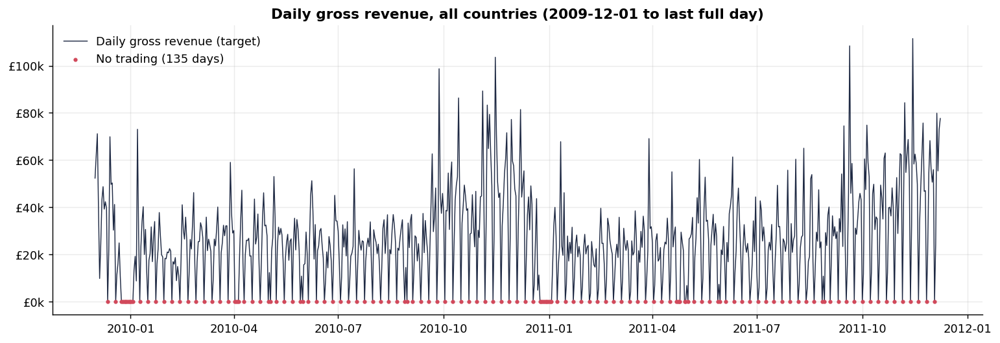
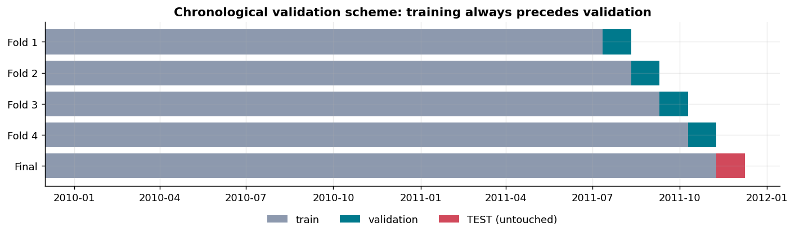
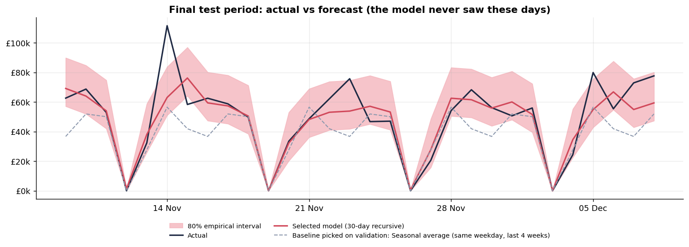
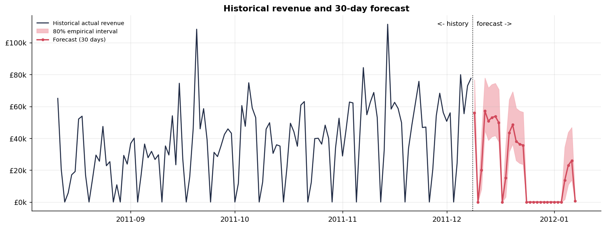

# Retail Sales Forecasting & Analytics Dashboard

An end-to-end data science project: from 1,067,371 raw retail transaction lines to a validated 30-day revenue forecast and an interactive Streamlit dashboard, built with time-series-safe methodology (chronological validation, leakage audit, baselines first).

## Overview

* **Data:** UCI *Online Retail II*, real transactions of a UK online gift retailer, 2009-12-01 to 2011-12-08 (CC BY 4.0).
* **Target:** daily gross product revenue in GBP, all countries combined.
* **Method:** data audit and documented cleaning rules, time-series analysis, leakage-safe lag/rolling/calendar features, four baselines, three model families (Linear Regression, Random Forest, XGBoost), expanding-window validation, one-time final test, recursive 30-day forecast with empirical prediction intervals.
* **Result in one line:** the selected model (**XGBoost (n=400, depth=5, lr=0.03)**) has a 30-day recursive test MAE of **£8,674** versus £12,763 for the best baseline on the same test period (32% lower), with important caveats listed under [Limitations](#limitations).
* **Different from a classification project:** this is a forecasting problem, so the workflow centres on time ordering, temporal features, rolling validation and baselines, not on class imbalance or SMOTE.

## Business Problem

A retailer with strongly seasonal, volatile daily sales needs to plan stock and staffing. Questions addressed: *How do revenue, seasonality and closures behave? How much revenue should we expect over the next 30 days, and how uncertain is that? Does a model beat simple rules of thumb enough to be worth using?*

## Dataset

| | |
|---|---|
| Name | Online Retail II |
| Source | UCI Machine Learning Repository, https://archive.ics.uci.edu/dataset/502/online+retail+ii |
| License | CC BY 4.0 (attribution required; see `data/README.md`) |
| Raw size | 1,067,371 rows x 8 columns in two overlapping sheets |
| Columns | `Invoice`, `StockCode`, `Description`, `Quantity`, `InvoiceDate`, `Price`, `Customer ID`, `Country` |
| Target | `revenue` = daily sum of `Quantity x Price` over cleaned lines (GBP) |
| Modeling series | 738 days (603 trading days) |

The raw file is **intentionally not committed** (about 45 MB, freely downloadable). See [Dataset Setup](#dataset-setup). Citation: Chen, D. (2012). *Online Retail II* [Dataset]. UCI Machine Learning Repository. https://doi.org/10.24432/C5CG6D

## Project Objectives

1. Audit and clean transactional data transparently, with no silent deletions.
2. Understand trend, seasonality, closures and volatility of daily revenue.
3. Build leakage-safe temporal features and prove it with executable checks.
4. Compare models against honest baselines using chronological validation.
5. Select the model on validation only and evaluate once on an untouched test set.
6. Deliver a 30-day forecast with uncertainty, plus a dashboard that never retrains.

## Architecture

```
raw Excel (2 sheets) ──► load + standardize ──► cleaning waterfall (1 status per row)
        ──► daily table (target + business metrics) ──► features (calendar, lags, rolling)
        ──► validation on pool (expanding windows) ──► select model ──► ONE test evaluation
        ──► refit on all data ──► saved model + metadata ──► recursive 30-day forecast
        ──► Streamlit dashboard (loads artifacts only)
```

## Data Processing

Every raw row receives exactly one status (see `reports/data_audit.md` for all numbers):

| Status | Rows | Quantity x price (£) |
|---|---|---|
| sheet_overlap_duplicate | 22,523 | 377,488 |
| cancellation | 19,165 | -1,465,304 |
| nonpositive_quantity | 3,393 | 0 |
| nonpositive_price | 2,636 | -158,676 |
| non_product | 4,489 | 831,031 |
| same_day_reversal | 1,250 | 340,430 |
| partial_last_day | 1,617 | 29,645 |
| included | 1,012,298 | 19,332,636 |

Highlights:

* The two workbook sheets **overlap** for early December 2010. The loader verifies the overlapping rows are identical, then keeps one copy.
* **Cancellations** (`C` invoices), stock adjustments, non-positive prices and non-product codes (postage, fees, manual lines) are excluded from the target but **tracked separately** in the daily table; returns are never netted into revenue.
* Orders cancelled by the same customer for the same item and quantity **later the same day** are treated as corrections and set aside. This matters: the biggest raw "order" (about £77k on 2011-01-18) was reversed 16 minutes later.
* The final day (2011-12-09) is only partly recorded (ends 12:50) and is excluded.
* Days without sales are explicit zeros (nothing is interpolated): 135 of 738 days, namely Saturdays (closed), UK holidays and 24 Dec - 3 Jan.

## Exploratory Analysis

Notebooks 01-02 (figures in `reports/figures/`). Findings (details in `reports/insights.md`):

* Strong **autumn peak**: in 2010, September-November delivered 36% of the year's revenue.
* **Weekly rhythm**: Saturday closed, Sunday about half a weekday; the strongest autocorrelation is at lag 7.
* **Closures are predictable**: every non-Saturday zero day in the training pool is a UK holiday or falls in 24 Dec - 3 Jan.
* **Volatile**: the standard deviation of trading-day revenue is about half of its mean.
* **Modest growth**: Sep-Nov 2011 vs 2010 +5.5%.



## Forecasting Methodology

* **Frozen chronological split** (decided from the calendar before modeling): pool 2009-12-01 to 2011-11-08; **final test set = last 30 days** (2011-11-09 to 2011-12-08).
* **Validation:** four expanding-window folds of 30 days inside the pool; training always ends before validation starts. Ordinary random K-fold is not used because it would train on days after the ones it is scored on, and neighbouring days are strongly autocorrelated.
* **Features** (`src/feature_engineering.py`): calendar (weekday, month, quarter, week/day of year, day of month, weekend), `is_uk_holiday`, `is_year_end_closure`; lags 1, 7, 14, 28; rolling means over the previous 7, 14, 28 days (window ends the day before the prediction date).
* **Recursive forecasting:** each day's prediction feeds the next day's lag/rolling features; no actual future value is ever used.
* **Known closures:** holidays and 24 Dec - 3 Jan are forecast as exactly zero (for models **and** baselines, so comparisons stay fair). This rule is justified by the pool alone (see `reports/leakage_audit.md`, section B).
* **Prediction interval:** empirical 80% band from out-of-sample validation residuals (separately for open and closed-calendar days). It is an approximation, not a statistical guarantee.



## Models

| Family | Why | Configurations tried |
|---|---|---|
| Baselines (4) | the bar every model must clear | naive; seasonal naive; 7-day moving average; same-weekday average of last 4 weeks |
| Linear Regression | simple, explainable; one-hot weekday and month, scaled lags (scaler inside the pipeline) | 1 |
| Random Forest | non-linear, robust | 6 (depth 4/8/unlimited x min leaf 1/3), 300 trees |
| XGBoost | strong tabular learner | 8 (200/400 trees x depth 3/5 x learning rate 0.03/0.1) |

No deep learning: with about 700 daily observations it would add complexity without evidence of benefit.

## Evaluation

* **Primary metric: MAE** (average daily miss in pounds). It is easy to explain, robust to the occasional huge day, and well-defined on closed days.
* **RMSE** (punishes large misses), **WAPE** (total absolute error as % of total revenue; valid with zero days), **sMAPE on trading days** (plain MAPE is undefined when actual revenue is 0) and **R²** (supplementary only).
* **Two protocols:** *30-day recursive* (primary; how the deployed forecast works) and *1-day-ahead* (secondary).
* **Selection rule (fixed in advance):** lowest mean validation MAE under the 30-day recursive protocol. The test set was scored once, for the selected model only (plus the untuned baselines for reference).

## Results

### Validation (mean of 4 folds, 30-day recursive; used for selection)

| Model | MAE (£) | RMSE (£) | sMAPE, trading days (%) | WAPE (%) | R² |
|---|---|---|---|---|---|
| XGBoost (n=400, depth=5, lr=0.03) | 8,490 | 12,866 | 28.7 | 27.8 | 0.55 |
| Random Forest (depth=None, min_leaf=1) | 9,147 | 13,601 | 30.4 | 29.6 | 0.50 |
| Linear Regression | 9,365 | 13,130 | 29.3 | 30.2 | 0.53 |
| Seasonal average (same weekday, last 4 weeks) | 10,594 | 15,080 | 36.0 | 33.8 | 0.41 |
| Seasonal naive (same weekday last week) | 11,601 | 16,738 | 38.7 | 37.0 | 0.26 |
| Moving average (last 7 days) | 15,241 | 20,010 | 38.8 | 49.1 | -0.07 |
| Naive (last observed day) | 18,255 | 22,536 | 55.1 | 56.9 | -0.42 |

### Final test set (last 30 days, evaluated once, 30-day recursive)

| Model | MAE (£) | RMSE (£) | sMAPE, trading days (%) | WAPE (%) | R² |
|---|---|---|---|---|---|
| XGBoost (n=400, depth=5, lr=0.03) | 8,674 | 13,276 | 16.9 | 17.5 | 0.74 |
| Seasonal naive (same weekday last week) | 12,763 | 16,163 | 26.8 | 25.7 | 0.61 |
| Seasonal average (same weekday, last 4 weeks) | 13,343 | 19,085 | 28.5 | 26.9 | 0.46 |
| Naive (last observed day) | 18,859 | 26,443 | 24.4 | 38.0 | -0.04 |
| Moving average (last 7 days) | 19,330 | 25,939 | 26.8 | 39.0 | -0.00 |

### 1-day-ahead protocol (secondary)

Validation:

| Model | MAE (£) | RMSE (£) | sMAPE, trading days (%) | WAPE (%) | R² |
|---|---|---|---|---|---|
| XGBoost (n=400, depth=5, lr=0.03) | 9,018 | 12,972 | 30.7 | 29.3 | 0.54 |
| Random Forest (depth=None, min_leaf=1) | 9,272 | 13,304 | 31.6 | 30.0 | 0.52 |
| Linear Regression | 9,364 | 12,925 | 29.5 | 30.4 | 0.55 |
| Seasonal average (same weekday, last 4 weeks) | 10,093 | 14,205 | 35.0 | 32.7 | 0.46 |
| Seasonal naive (same weekday last week) | 11,428 | 16,074 | 39.0 | 36.4 | 0.32 |
| Moving average (last 7 days) | 14,980 | 19,536 | 36.7 | 48.5 | -0.03 |
| Naive (last observed day) | 19,523 | 24,488 | 71.2 | 63.5 | -0.64 |

Test:

| Model | MAE (£) | RMSE (£) | sMAPE, trading days (%) | WAPE (%) | R² |
|---|---|---|---|---|---|
| XGBoost (n=400, depth=5, lr=0.03) | 8,198 | 13,183 | 15.6 | 16.5 | 0.74 |
| Seasonal naive (same weekday last week) | 10,856 | 16,584 | 20.9 | 21.9 | 0.59 |
| Seasonal average (same weekday, last 4 weeks) | 11,600 | 16,238 | 24.1 | 23.4 | 0.61 |
| Moving average (last 7 days) | 20,315 | 26,287 | 29.9 | 41.0 | -0.03 |
| Naive (last observed day) | 24,668 | 31,804 | 58.0 | 49.8 | -0.50 |



**How to read these results honestly**

* The selected model beat the best validation baseline by 20% on average MAE, in **3 of 4 folds** (in fold 1 the two are effectively tied). **No model wins every fold**, and the differences between the top models are small compared with fold-to-fold variation.
* Rankings depend on the metric: for example Linear Regression has a lower RMSE than Random Forest, and a different XGBoost configuration has a slightly lower RMSE than the selected one. MAE was chosen as the primary metric before looking at results.
* The best baseline on validation (same-weekday 4-week average) is **not** the best baseline on test (seasonal naive); baselines were not tuned on test.
* WAPE and R² look better on the test period than on validation partly because November revenue is higher (a larger denominator), while absolute MAE is similar. That is a property of the window, not a better model.
* The empirical 80% interval contained 83% of the 30 test days (a small-sample check).

### The 30-day forecast

Saved at `data/processed/forecast_30d.csv`: **2011-12-09 to 2012-01-07**, total **£621,338**, 17 days with revenue and 13 zero days (holidays, year-end closure, closed Saturdays).



**Caution:** the mid-December level (9-23 Dec) is +34% above the same dates in 2010, much more than the observed year-on-year growth (+5.5% for Sep-Nov). The model has seen only two full Decembers. Treat the *shape* of the forecast (busy until about 23 December, closed afterwards, quieter restart) as more dependable than its exact pound values.

## Dashboard

`app/app.py` is a Streamlit app with six sections: **Executive Overview** (total revenue, average daily revenue, invoices, unique customers, forecast horizon, latest actual revenue), **Historical Sales** (daily/weekly/monthly with rolling averages), **Sales Analysis** (weekday and month seasonality, countries, cancellations), **Forecast** (history + forecast + empirical interval, table, CSV download), **Model Performance** (baselines, validation, test, final model details) and **Business Insights**.

Controls: date range, country selection, forecast horizon (1-30 days). The app **only loads saved artifacts** (processed CSVs, `models/final_model.joblib`, `models/model_metadata.json`); it never trains or fits anything, and invalid input (reversed or incomplete date range, empty selections) is handled with messages instead of errors. It was exercised with Streamlit's headless test harness (`tests/test_app.py`), not in a browser, so no screenshots are included.

## Key Business Insights

(Full list with evidence in [`reports/insights.md`](reports/insights.md).)

* **Scale of the business.** Gross revenue over the 738-day period is **£19,332,636** from 39,358 invoices on 603 trading days: about **£32,061 per trading day** (median £27,974).
* **A strong autumn peak.** In 2010, September to November delivered **36%** of the calendar year's revenue, and November alone **15%**. Revenue per trading day was £55,031 in November 2010 versus £22,472 in February 2010.
* **Modest growth.** Revenue for January to November 2011 was **+2.3%** versus January to November 2010; September to November was **+5.5%**; November 2011 alone was +1.4% versus November 2010.
* **A fixed weekly and holiday rhythm.** Saturday is effectively closed: **104 of 105 Saturdays** had no sales at all. Sunday trades at roughly **52%** of the average weekday level.
* **Day-to-day volatility.** On trading days the standard deviation is about **52%** of the mean: a typical day can be far above or below the average. The strongest single day in the period is £111,531 on 2011-11-14.
* **Cancellations and returns.** Cancelled value (invoices starting with `C`) equals **6.7%** of gross revenue, and cancellation invoices are about 17% of all invoices (cancellation + sales invoices).
* **Customers.** 5,850 distinct customer IDs account for 87% of revenue; the rest (22% of lines, 13% of revenue) has no customer ID.
* **Geographic concentration.** The United Kingdom provides **85.4%** of revenue; the top five countries together 95.0% (across 43 countries). EIRE ranks second (3.2%) with only 3 customer IDs.

Findings are labelled *observed*, *model* or *interpretation*; correlation here does not establish causes and forecasts are not guarantees.

## Leakage Prevention

Documented risk by risk in [`reports/leakage_audit.md`](reports/leakage_audit.md). Key safeguards:

* chronological split; no random splitting anywhere (enforced by a test that scans the source);
* lags use `shift(k >= 1)`, rolling means use `shift(1).rolling(w)`; executable checks rewrite today and the entire future and show no feature of today moves;
* no imputation; the only scaler is inside a pipeline fitted on training rows;
* validation and selection receive only the pool, proven by a test that shifts the test period by 75,000 and shows validation results, selection and interval quantiles are unchanged;
* recursive forecasting appends the target day as NaN so its own value cannot influence its features;
* the audit also records one development iteration (a closure rule added after the first run) and why it was not test-set tuning.

## Project Structure

```
retail-sales-forecasting/
├── app/
│   └── app.py
├── data/
│   ├── processed/
│   │   ├── cleaning_log.csv
│   │   ├── country_daily.csv
│   │   ├── country_summary.csv
│   │   ├── daily_metrics.csv
│   │   ├── forecast_30d.csv
│   │   ├── summary.json
│   │   ├── test_predictions.csv
│   │   └── validation_predictions.csv
│   ├── raw/
│   │   └── .gitkeep
│   └── README.md
├── models/
│   ├── final_model.joblib
│   └── model_metadata.json
├── notebooks/
│   ├── 01_data_exploration.ipynb
│   ├── 02_time_series_analysis.ipynb
│   ├── 03_feature_engineering.ipynb
│   ├── 04_model_training_evaluation.ipynb
│   └── 05_forecast_analysis.ipynb
├── reports/
│   ├── figures/   # 19 PNG charts written by the notebooks
│   ├── data_audit.md
│   ├── hyperparameter_search.csv
│   ├── insights.md
│   ├── leakage_audit.md
│   ├── model_comparison.csv
│   └── validation_fold_metrics.csv
├── src/
│   ├── __init__.py
│   ├── config.py
│   ├── data_preprocessing.py
│   ├── evaluate.py
│   ├── feature_engineering.py
│   ├── forecast.py
│   ├── plotting.py
│   └── train.py
├── tests/
│   ├── conftest.py
│   ├── test_app.py
│   ├── test_artifacts.py
│   ├── test_data_preprocessing.py
│   ├── test_evaluate.py
│   ├── test_feature_engineering.py
│   ├── test_forecast.py
│   ├── test_project_hygiene.py
│   └── test_training.py
├── .gitignore
├── LICENSE
├── README.md
└── requirements.txt
```

## Installation

Requires **Python 3.12** (the versions in `requirements.txt` were verified with it).

```bash
git clone <your-repository-url>
cd retail-sales-forecasting
python -m venv .venv
source .venv/bin/activate          # Windows PowerShell: .\.venv\Scripts\Activate.ps1
pip install -r requirements.txt
```

## Dataset Setup

Download the official file and place it at `data/raw/online_retail_II.xlsx` (instructions, direct link and SHA-256 in [`data/README.md`](data/README.md)). The raw file is **not required** to run the tests, the dashboard or notebooks 02-05, because the processed data and the trained model are included. It is required only to rebuild everything from scratch:

```bash
python -m src.data_preprocessing   # raw Excel -> data/processed/ (about 1-2 minutes)
python -m src.train                # validation, selection, one test evaluation, save model (about 1 minute)
```

## Running the Notebooks

Open the notebooks in VS Code (uses `ipykernel`) or install JupyterLab (`pip install jupyterlab`). Run them from the project root or from `notebooks/`, in order `01` to `05`. Notebook 01 reads the raw file (about 2 minutes); notebooks 02-05 use the processed data and saved artifacts. To re-execute one from the command line:

```bash
jupyter nbconvert --to notebook --execute --inplace notebooks/03_feature_engineering.ipynb
```

All notebooks in the repository were executed end to end and contain their real outputs.

## Running the Tests

```bash
pytest
```

Last full run: **101 passed** (preprocessing rules, loading, feature correctness, leakage, chronological splitting, metrics, baselines, recursive forecasting, training workflow, saved artifacts, the Streamlit app, repository hygiene).

## Running the Streamlit Dashboard

```bash
streamlit run app/app.py
```

Run it from the project root.

## Reproducibility

* Pinned dependencies; fixed random seed (42); deterministic training.
* Verified in a **brand-new virtual environment** created only from `requirements.txt`: re-running `python -m src.data_preprocessing` and `python -m src.train` from the raw file regenerated all data, prediction and metric files **byte-for-byte identical** to those in this repository, selected the same model, and `pytest` passed there too.
* The saved model, metadata (features, hyperparameters, split dates, metrics, package versions) and a reload check that must reproduce the forecast are written by `src/train.py`.
* Results come from the file with SHA-256 `bcbe73b35f5b7babf197fb0cb983a11f5d9ff929078d4aa53d171b1f2df2e980` (UCI does not publish a checksum).

## Limitations

* **Short history.** About two years: one complete autumn peak before the test window and only two full Decembers. Seasonal patterns are learned from very little data, and the model can be wrong in level when the season changes.
* **The December forecast looks optimistic** (see the caution above). The shape is more trustworthy than the pound values.
* **Small, noisy evaluation.** Four 30-day validation windows and one 30-day test window of a single business; the winner does not win every fold, and the validation score of the selected model is slightly optimistic because it was chosen among 15 configurations on the same folds.
* **Daily revenue is intrinsically noisy.** One-off spikes (for example 2011-11-14) cannot be anticipated from past revenue and the calendar, and the data does not say why they happen.
* **Judgement calls in cleaning**: the same-day reversal rule affects about 0.9% of revenue; exact within-sheet duplicates are kept; the non-product code list was compiled by inspection. All are documented and tracked, and can be changed in `src/config.py` and `src/data_preprocessing.py`.
* **Calendar rules from two years.** Holiday and year-end closure rules match 100% of the training pool but would need revisiting if opening patterns change; the calendar is UK/England-based and includes only one one-off holiday (2011-04-29).
* **Gross revenue**, not net of returns; about 22% of lines have no customer ID, so customer metrics cover most but not all sales.
* **Total revenue only.** No country- or product-level forecasts and no external information (promotions, marketing, large known orders).
* **Interval is empirical** and approximate; the final saved model is refit on all data, so its own accuracy cannot be measured on held-out days.
* The dashboard was tested headlessly, not in a browser; no screenshots are provided.

## Future Improvements

* More history, or an external calendar (promotions, marketing), to learn seasonality better.
* Forecast by country or product group; hierarchical reconciliation.
* Weekly forecasts for planning, and quantile models for model-based intervals.
* Time-series cross-validation with more folds and a rolling-origin retraining schedule; monitoring of forecast error after deployment.
* Classical benchmarks (exponential smoothing, SARIMA) for comparison.

## License

The **code** is released under the MIT License (see `LICENSE`). The **dataset** is not covered by that license: it is UCI *Online Retail II*, licensed CC BY 4.0, and must be attributed as shown in [`data/README.md`](data/README.md).
